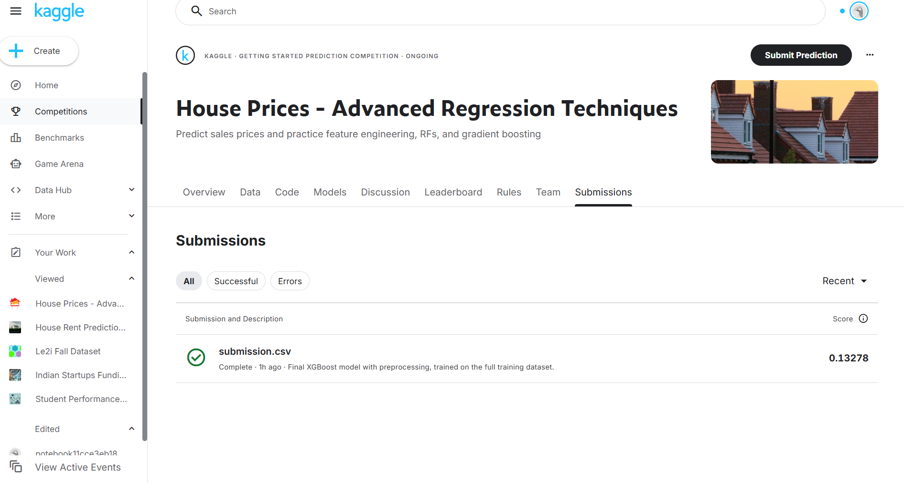

# House Price Prediction

## 📌 Project Overview

This project focuses on predicting house sale prices using machine learning. 
The project was developed using the Kaggle **House Prices: Advanced Regression Techniques** dataset.

The main goal was to understand and implement a complete machine learning workflow, 
from data exploration and preprocessing to model training, evaluation, and generating 
predictions for Kaggle submission.

## 🛠️ Technologies Used

- Python
- Jupyter Notebook
- Pandas
- NumPy
- Matplotlib
- Seaborn
- Scikit-learn

## 🔄 Machine Learning Workflow

1. Loaded and explored the dataset
2. Performed data cleaning
3. Handled missing values
4. Analyzed numerical and categorical features
5. Applied feature preprocessing
6. Encoded categorical variables
7. Built preprocessing pipelines
8. Trained machine learning regression models
9. Evaluated model performance
10. Generated predictions for the Kaggle test dataset
11. Submitted predictions to Kaggle

## 📊 Data Preprocessing

The following preprocessing techniques were used:

- Missing value handling
- Numerical feature preprocessing
- Categorical feature encoding
- Feature transformation
- Scikit-learn Pipeline

## 🤖 Machine Learning

The project uses regression-based machine learning techniques to predict house sale prices.

Model performance was evaluated using:

- Mean Absolute Error (MAE)
- Root Mean Squared Error (RMSE)
- R² Score

## 🏆 Kaggle Result

The final predictions were submitted to the Kaggle House Prices competition.

**Kaggle Submission Score: 0.13278**

## 📁 Project Structure

```text
house-price-prediction/
│
├── House_Price_Prediction.ipynb
├── README.md
└── screenshots/
    └── kaggle_score.png


## 🎯 Learning Outcomes

Through this project, I gained practical experience in:

- Machine learning regression
- Data preprocessing
- Handling missing data
- Categorical feature encoding
- Building ML pipelines
- Model evaluation
- Preparing Kaggle submissions

## Dataset

**Dataset:** [Kaggle - House Prices: Advanced Regression Techniques](https://www.kaggle.com/competitions/house-prices-advanced-regression-techniques)

## 👩‍💻 Author

**Keerthana**  
B.Tech Artificial Intelligence & Data Science

## 🏆 Kaggle Result

**Kaggle Score:** `0.13278`

